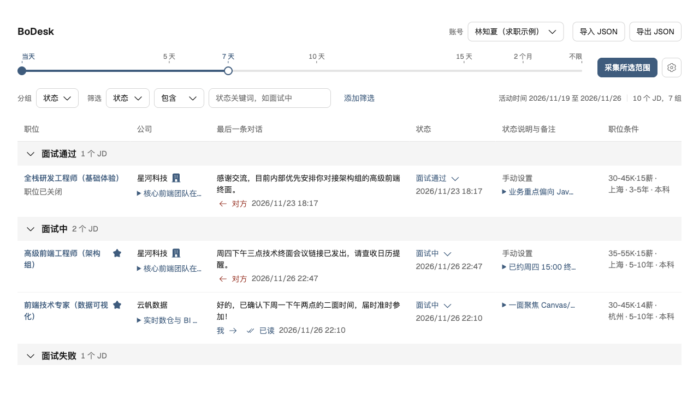
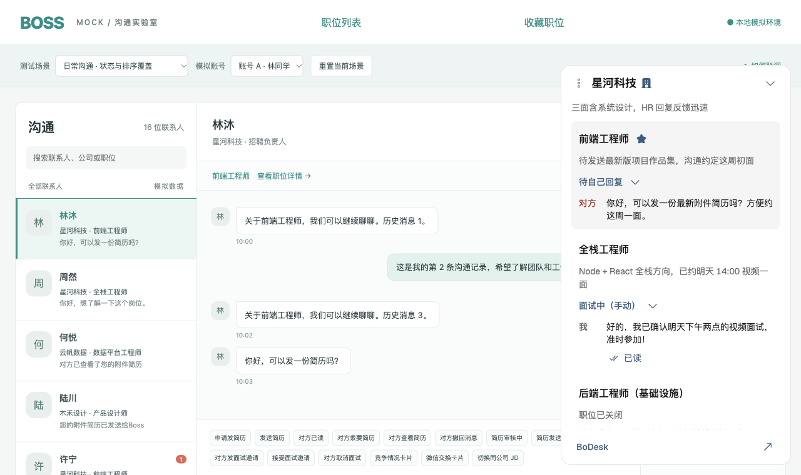
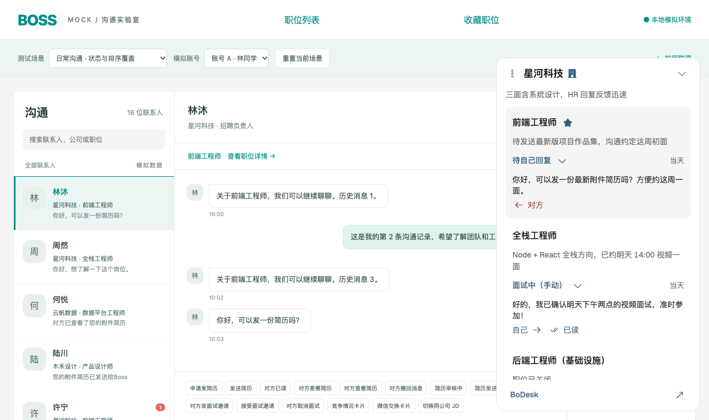
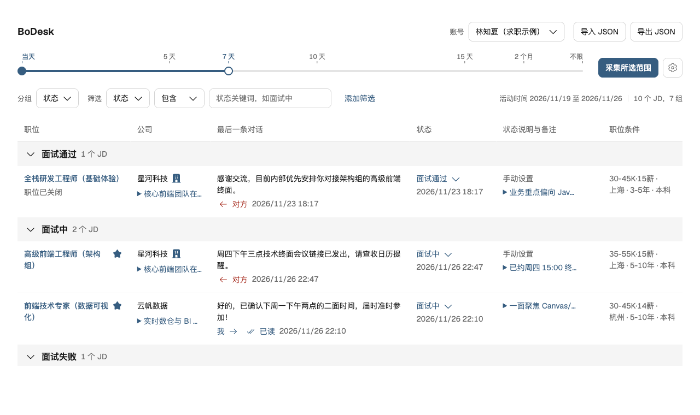

<div align="center">
  
  <h1>BoDesk</h1>
  <p><strong>BOSS直聘个人本地求职工作台</strong> · 沟通页轻量悬浮记录，独立看板统筹全流程进度与历史消息</p>
  <p>
    
    
    
    
  </p>
  <p>
    <a href="#为什么用-bodesk">为什么用</a> ·
    <a href="#界面与交互演示">界面演示</a> ·
    <a href="#核心特性">核心特性</a> ·
    <a href="#3-步安装使用">3 步安装</a> ·
    <a href="#隐私与安全边界">隐私边界</a> ·
    <a href="#常见问题">常见问题</a> ·
    <a href="#本地开发与目录结构">本地开发</a>
  </p>
</div>

<p align="center">
  
</p>

> [!NOTE]
> BoDesk 为纯本地只读辅助工具：所有沟通摘要、状态推导与备注均保存在浏览器扩展私有 IndexedDB 中，支持一键 JSON 备份，不上传任何服务器，也不会代发消息或自动投递简历。

---

## 为什么用 BoDesk

在多个公司、多个相似岗位间同步推进面试时，原生聊天列表很难回答「这家公司还有哪些岗位在聊」「上次沟通到哪一步」「对方最后问了什么」。BoDesk 将碎片化沟通整理为可持续追踪的职位工作台：

| 常见求职痛点 | BoDesk 的本地解法 |
| --- | --- |
| 同公司多个 JD 分散在不同联系人卡片下，容易重复沟通 | **右下角悬浮卡片**按公司自动聚合所有已聊、已收藏与已关闭 JD |
| 投递一多就忘记哪些约了面试、哪些只是对方看过简历 | 自动识别 **16+ 种状态阶段**，也支持手动覆盖与随时还原「跟随自动判断」 |
| 聊天列表容易刷走，难分辨最后一句是谁发的、对方读了没有 | **#a83226 红色标出最近对方发言**，**#365d80 蓝色标出我方已读回执**，支持公司与职位级备注 |
| 不敢使用第三方云端求职插件，担心 Cookie 或聊天隐私泄露 | **100% 本地 IndexedDB**，入库前丢弃 `securityId` 与凭据，仅在本地统计与导出 |

---

## 界面与交互演示

> 以下截图与动图全部基于 BoDesk 本地 mock 实验室与虚构求职示例数据录制，不含任何真实账号或聊天隐私。

### 1. 沟通页 / 职位页悬浮工作台

打开 BOSS直聘沟通页、职位详情页或公司职位列表页，右下角自动显示当前公司的 BoDesk 悬浮面板（支持任意拖拽定位与平滑收起为 `BoDesk` 胶囊按钮）。

<p align="center">
  
</p>

- **原位操作状态与备注**：无需跳出沟通界面，点击状态徽章即可弹出修订面板并二次确认，支持补充最长 10,000 字的 JD 备注与公司备注。
- **不遮挡聊天区**：点击右上角收起按钮，浮窗平滑折叠为带 `BoDesk` 标识的轻量胶囊，需要时一键恢复展开。

<p align="center">
  
</p>

---

### 2. 独立全屏看板与状态流转

点击浮窗底部的「**BoDesk**」或浏览器工具栏中的 BoDesk 图标，打开全屏工作台统一管理全部沟通中的机会：

<p align="center">
  
</p>

- **时间窗精确回溯**：通过顶部双滑块选定近期活动范围，按需触发只读增量历史补全。
- **灵活分组与组合筛选**：支持按「状态」或「公司」切换分组视图，结合状态、关键词与备注多条件过滤目标岗位。
- **高密度信息列**：同屏呈现职位名称与收藏状态、公司备注折叠预览、最近一条人类对话（自动过滤干扰系统提示）、状态更新时间及薪资地点等职位条件。

---

## 核心特性

- **双入口协同**：在沟通页与职位详情页右侧原位看状态、写备注；在独立看板总览全局与多维筛选。
- **自动推导 + 人工兜底**：结合消息方向、简历事件（请求 / 已发送 / 已查看 / 发送失败 / 拒绝）与面试邀约卡片自动计算状态，人工修订支持确认弹窗并保留来源标识，可随时切回「跟随自动判断」。
- **收藏与失效感知**：识别页面职位收藏、公司关注与已关闭/下架岗位，避免在已关闭 JD 上浪费跟进精力。
- **多账号与环境严格隔离**：按账号维度与站点来源分域建库；访问本地 `mock/` 实验室时自动归入模拟命名空间，真实账号数据保持完全干净独立。
- **全量 JSON 备份迁移**：看板支持一键导出当前账号的完整 JSON 快照与恢复导入，换机或重装扩展不丢记录。

---

## 3 步安装使用

> [!IMPORTANT]
> 目前以源码本地构建后通过 Chrome / Edge **加载已解压扩展程序** 方式安装使用。加载时请选择仓库根目录下的 **`extension/`** 目录，**不要**选择 `extension/dist/`（`manifest.json` 位于 `extension/` 内）。

### 环境要求

- Node.js `^22.22.2 || ^24.15.0 || >=26.0.0`

### 1. 克隆仓库并构建扩展

```bash
git clone <your-repo-url>
cd 16_boss_help
npm install
npm run build
```

### 2. 加载到 Chrome / Edge

1. 在浏览器地址栏打开 `chrome://extensions`（Edge 请打开 `edge://extensions`）。
2. 开启右上角的 **开发者模式**。
3. 点击 **加载已解压的扩展程序**，选择本项目中的 **`extension/`** 文件夹。

### 3. 开始追踪

1. 登录 BOSS直聘并打开任意「沟通」或「职位详情」页面，右下角即可看到 **BoDesk** 浮窗。
2. 正常浏览会话即可自动积累状态记录；点击浮窗底部的 **BoDesk** 按钮（或工具栏 BoDesk 图标），可展开活动时间滑块、组合筛选与全量同步设置。

---

## 隐私与安全边界

BoDesk 在设计上遵循最小权限与本地优先原则，具体数据与网络边界如下（详版说明见 [extension/README.md](extension/README.md)）：

- **零外部传输**：除连接你正在访问的 BOSS直聘页面或本地 mock 服务外，扩展不向任何第三方服务器发送请求。
- **只读不写站点状态**：仅被动观察当前页面的聊天数据与只读历史接口（`getBossData`、`historyMsg`），**绝不**调用发送消息、发送简历或标记已读接口。
- **入库字段白名单过滤**：写入本地数据库前主动剔除 `securityId`、Cookie、鉴权 Token 与头像等无关或敏感字段。
- **真实站点限速与异常保护**：在真实 BOSS 页面主动补全历史时，默认每次请求至少间隔 `3` 秒（可在 `1–15` 秒调整），每 `20` 次请求强制休息 `20` 秒；遇到 `429`、`401`、`403` 或返回结构异常时立即中止任务并进入冷却保护，已保存记录不会丢失。

---

## 常见问题

<details>
<summary><strong>安装打包后，其他人打开扩展会出现模拟测试数据吗？</strong></summary>

不会。BoDesk 按页面来源与账号哈希隔离存储，只有在本地访问模拟站点（`http://127.0.0.1:4173` / `http://localhost:4173`）时才会创建独立的 mock 账号记录；真实 BOSS直聘账号从零记录真实页面观测与采集数据，互不污染。

</details>

<details>
<summary><strong>不点击「采集所选范围」，BoDesk 也会记录数据吗？</strong></summary>

会。只要在沟通页切换联系人、收到新消息或访问职位详情页，BoDesk 就会被动观察当前上下文与接口响应并实时入库。「采集所选范围」仅用于按时间滑块区间主动补齐更早的历史对话，使多页状态与最新消息更完整。

</details>

<details>
<summary><strong>手动改了职位状态后，还能恢复自动判断吗？</strong></summary>

可以。点击任意职位状态徽章打开修订弹窗，选择第一项 **「跟随自动判断」** 并确认后，BoDesk 会立即根据该职位历史沟通与系统消息重新展示自动推导状态。

</details>

<details>
<summary><strong>如何导出数据或迁移到另一台电脑？</strong></summary>

在 BoDesk 看板右上角点击 **导出 JSON** 即可保存当前账号全部职位、公司、对话与备注快照；在新设备安装 BoDesk 后点击 **导入 JSON** 选择备份文件即可无损恢复。

</details>

---

## 本地开发与目录结构

如果你希望参与扩展样式、功能改进或通过模拟场景测试极端边界（如 `429` 限速、`401` 失效、多页游标停滞、方向缺失等），可直接启动项目内置的 **Mock BOSS 沟通实验室**：

```bash
npm run dev
```

启动后在浏览器打开 `http://127.0.0.1:4173/web/geek/chat`，确保已在扩展管理页加载 `extension/`，即可在零真实账号风险的环境下调试全链路功能（运行说明见 [mock/README.md](mock/README.md)）。

<details>
<summary><strong>展开查看常用 npm 命令与项目目录结构</strong></summary>

### 常用命令

| 命令 | 说明 |
| --- | --- |
| `npm run dev` | 启动 Vite 构建监听与本地模拟 BOSS 服务（默认 `http://127.0.0.1:4173`） |
| `npm run build` | 同时构建浏览器扩展与本地 mock 页面产物 |
| `npm run build:extension` | 仅构建扩展静态产物至 `extension/dist/` |
| `npm run typecheck` | 运行 TypeScript 类型检查（`tsc --noEmit`） |
| `npm test` | 运行扩展核心逻辑、构建与 mock 服务单元测试 |
| `npm run test:browser` | 在无头浏览器中运行端到端 UI 与交互冒烟测试 |
| `npm run check` | 运行 TypeScript 类型检查与 JavaScript 语法校验 |
| `npm run start` | 仅启动已构建完成的 mock 服务（生产静态产物模式） |
| `npm run research:export` | 运行聊天导出分析研究脚本（开发调研用） |

### 目录结构

```text
.
├── extension/            # Chrome/Edge MV3 扩展源码、manifest、图标与构建入口
├── mock/                 # 本地模拟 BOSS 服务端与前端实验室（/web/geek/chat 等）
├── tests/                # extension/ 与 mock/ 对应的自动化单元测试
├── scripts/              # 扩展构建脚本、本地联调服务与浏览器冒烟脚本
├── docs/
│   └── media/            # README 展示截图与交互动图（基于 mock 合成数据）
├── research/             # 结构研究文档与脱敏探索脚本
├── DESIGN.md             # 视觉与交互设计规范
├── package.json          # 统一依赖与 npm scripts
└── README.md             # 本说明文档
```

</details>

---

## 相关文档

- 扩展核心行为、权限、状态模型与安全机制：[extension/README.md](extension/README.md)
- 本地 mock 实验室与 15 种异常/边界场景说明：[mock/README.md](mock/README.md)
- 视觉规范、配色标尺与组件交互约定：[DESIGN.md](DESIGN.md)
- 聊天数据导出字段研究记录：[research/chat-export/README.md](research/chat-export/README.md)
