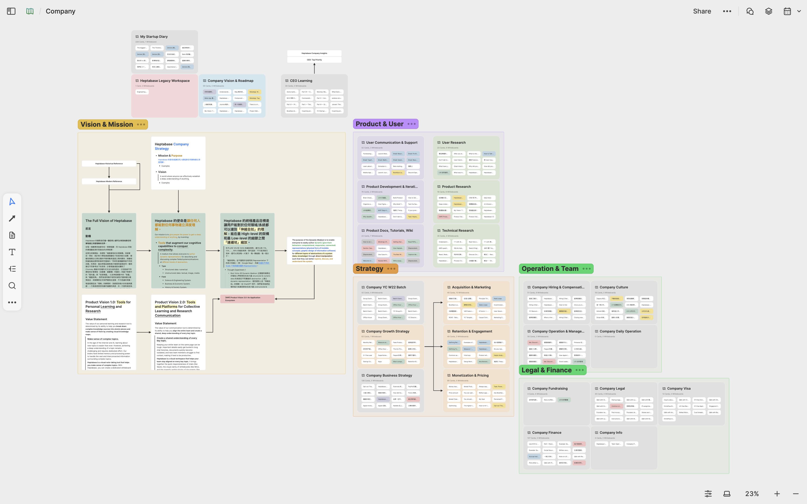

# JD 无限画布专项调研

2026 年 11 月 20 日。依据官方展示图、公开说明，以及项目当前浮窗和后台的数据结构。画布构图使用示例数据。竞品未登录实测。

## 结论

**最贴近当前扩展的是 Heptabase 式的公司地图，加上 Obsidian Canvas 式的职位卡片。** 画布可平移和缩放。拉远看有哪些公司、每家公司有多少职位和待跟进项。点进公司查看职位卡片。再点卡片展开原有浮窗里已经熟悉的状态、最新人工消息和备注。

同一批职位还可以切换成「按状态铺开」。例如先筛「收藏 + 上海」，然后按公司看机会集中在哪几家，再按状态看哪些需要自己回复。切换保留筛选和当前选中的职位。两种布局共享职位记录，便于从一个视角跳到另一个视角。

## 成熟案例与图片

### Heptabase · 把相关的卡片围进一个区域

Heptabase 用白板整理知识和项目。画布里的内容有空间位置，用户可以把相关卡片放在一起，看全局时先识别区域，需要时再进入局部。对应本项目，最大的区域标题是公司，区域内反复出现同一种职位卡片。公司区域头能承载公司备注入口和状态小计。适合有几家公司同时推进、每家又有不止一个职位的场景。

来源：[Heptabase Wiki · Organize knowledge and projects](https://wiki.heptabase.com/organize-knowledge-and-projects)。

### Obsidian Canvas · 文本卡、分区和有含义的连线

Obsidian Canvas 把可阅读的内容直接摆在画布上，卡片可以单独定位，关联可以画线。项目可以把职位卡缩成「标题 + 状态」，放大后露出最新人工消息的方向和一行摘要。公司与职位的归属已经能用区域表达。连线可留给点选单个职位后的沟通上下文，例如同一个会话中接触过两个职位；全局把每个会话都连上容易挡住卡片，也会把不确定的关联画得过于确定。

来源：[Obsidian Canvas](https://obsidian.md/canvas)。

### Milanote · 可手动摆放的工作板

Milanote 的白板适合把少量候选拉到一起，按自己的思路加笔记和摆放。可迁移成「临时比较区」：从公司地图选两三个职位放过去，视线集中在几张卡片的差异。每张卡仍然指向同一个本地职位。手动摆放适合用户主动整理的少量职位；全量职位区域可以由系统排布，避免每次同步都得重新收拾画布。

来源：[Milanote · Product](https://milanote.com/product)。

## 本项目画布长什么样

### A. 公司地图 · 默认查看候选

~~~text
职位画布    [按公司 ▾]   搜索公司或职位    [已收藏 ×] [上海 ×]

┌ 星河科技 · 3 个职位 ─────────────────┐    ┌ 示例数据 · 2 个职位 ──┐
│ 待自己回复 1  ·  面试中 1            │    │ 面试中 1  ·  待确认 1  │
│ ┌ 前端工程师 ─┐  ┌ 前端工程师 ─┐    │    └────────────────────────┘
│ │ 待自己回复  │  │ 待 Boss 回复│    │
│ │ Boss：这周… │  │ 我：已发…   │    │          ┌ 示例软件 · 1 ──┐
│ └─────────────┘  └─────────────┘    │          │ 待自己回复 1   │
│ 公司备注 · 查看                        │          └─────────────────┘
└───────────────────────────────────────┘

                                            [全览] [−]  75%  [+]
~~~

二维区域能沿两个方向展开。全览保留公司名、职位数、重点状态小计；点区域标题将视野移到公司。中等缩放看到职位名称、状态、收藏；近看再出现发送方和一行人工消息。点击卡片后在画布旁边展开详情，同时保留当前视野。浮窗入口带公司和职位 ID，进来就能看到当前职位周围的同公司机会。

### B. 状态地图 · 同一批职位依有效状态重排

~~~text
职位画布    [按状态 ▾]   搜索公司或职位    [已收藏 ×] [上海 ×]

┌ 待自己回复 · 2 ───────┐       ┌ 面试中 · 2 ──────────┐
│ 星河科技 · 前端工程师 │       │ 示例数据 · 平台工程师 │
│ 示例软件 · 全栈工程师 │       │ 星河科技 · 数据工程师 │
└────────────────────────┘       └────────────────────────┘

┌ 待确认 · 1 ──────────┐       ┌ 待 Boss 回复 · 1 ────┐
│ 示例数据 · 数据工程师 │       │ 星河科技 · 前端工程师 │
└────────────────────────┘       └────────────────────────┘
~~~

状态区域可以排成多行，每张卡带公司。保留项目现有状态含义，按状态浏览时可直接定位任一非空区域。点公司名可切回该公司的空间范围。状态来自有效状态字段，只在用户明确修改或数据更新时改变；拖动卡片用来移动视角或整理比较区。

### C. 自由工作板与关系图 · 适合作为局部视图

| 形式 | 在本项目怎么用 | 适用条件 |
| --- | --- | --- |
| 自由工作板 | 把想优先看的职位固定在同一区域，旁边记录一条比较备注 | 用户愿意手动布置，且收藏、状态变化后仍需保留布局 |
| 职位关系图 | 以选中职位为中心，展示公司、同公司职位，以及确有关联的会话 | 要查一条具体关系，且有可靠的职位和会话 ID |
| 缩放导航 | 概览看公司和计数，中层看职位，近层读摘要；搜索直接飞到匹配卡片 | 适用于全局地图，尤其是缩放后卡片变小或分区很多时 |

## 与浮窗共用的字段和规则

- **公司区域**用账号内公司 ID，标题放公司名，展开可看公司备注。缺失公司可归在「公司待识别」。搜索支持公司名和职位名。
- **职位卡片**用账号内职位 ID。公司内同名职位分别保留，优先用地点、原链接或有明确归属的沟通上下文区分。一份职位对应多条会话时只画一张职位卡。
- **状态与摘要**沿用浮窗的有效状态和发送方显示。没有人工消息、消息无法可靠归属、发送方未知各按现有信息呈现。全览可只显示计数，中层延迟加载视野内的摘要，点开后再读较长备注或会话。
- **筛选、坐标和计数**按公司与按状态使用同一批筛选结果。一个组内匹配减少时，可先把不匹配区域藏起来并保持其位置，清空条件后能认出原来的地图。公司和状态各自记住视野，切换后优先定位选中的职位。
- **范围和缺失**画布只计入当前账号的已记录可见职位；仅收藏可以出现，浮窗未持久化的当前职位可以单独预览。卡片沿用已采集信息，完整 JD 正文通过原链接查看。

项目依据：[当前浮窗实现](../extension/src/content.tsx) · [职位、会话及最新消息归属](../extension/src/background.ts) · [状态归并](../extension/src/core.ts) · [模拟场景](../mock/fixtures.ts)。[历史浮窗截图与字段核对](jd-view-research-round-2.md)。

## 原型验证

首个原型可用同一批 mock 数据做公司地图和状态地图，支持拖动画布、缩放、回到全览、点区域定位、搜索定位、切换布局和点卡展开。先验证以下任务，再决定自动布局要做到哪一步。

1. 从星河科技的某个职位浮窗进画布，能直接定位当前卡片，找到旁边的另一个同名职位。
2. 从公司地图拉远，能认出有哪些公司集中出现了「待自己回复」；再切状态地图，选中的职位和筛选都保留。
3. 选「收藏 + 上海」后，能看清条件匹配范围。清空筛选或关掉详情后，还能回到刚才看的区域。
4. 多会话、仅收藏和待识别职位都能合理显示。增加合成职位后，能靠搜索和全览回到目标，摘要及长备注不会遮住附近卡片。

当前首选 A 与 B 的组合。它同时覆盖按公司和按状态，也让浮窗保留就地看一家公司、全局画布负责跨公司穿梭的分工。真实账号的规模、字段覆盖和用户是否会用手动布局仍待验证。
