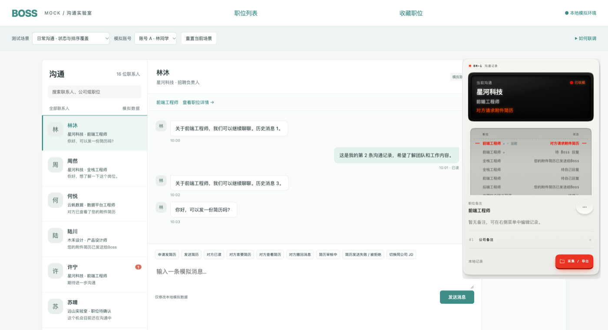
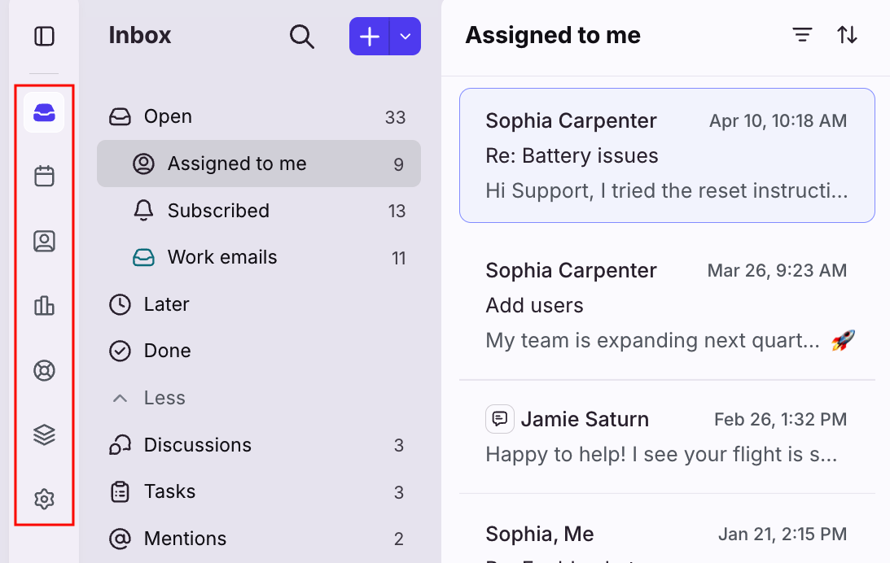
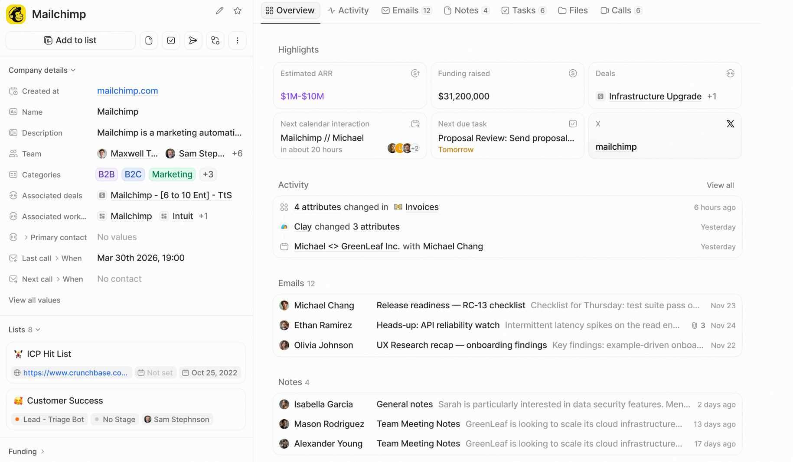
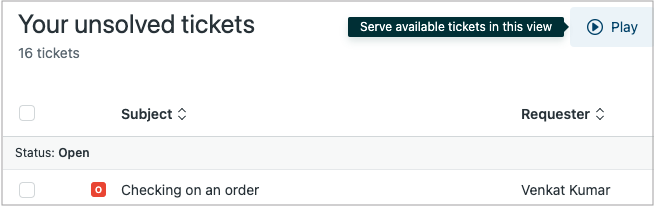
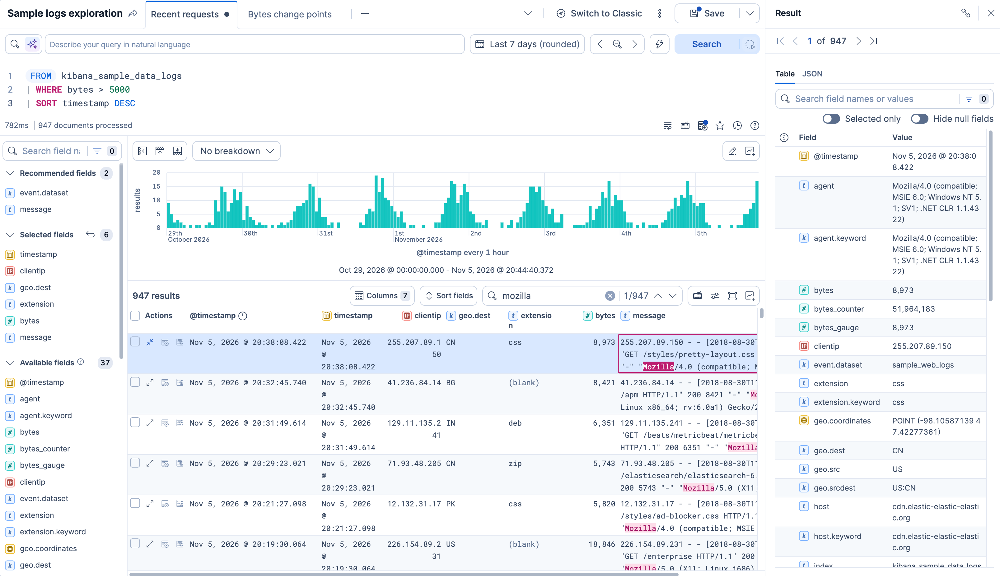

# JD 多维展示第二轮调研

2026 年 11 月 20 日。基于扩展当前工作区源码、本地模拟数据和既有浮窗截图。竞品依据公开产品文档和官方截图。模拟数据用于检查设计是否容纳现有关系，实际账号的记录分布与字段覆盖率尚未测量。

## 结论

**优先画两套可点击原型：跟进收件箱和公司档案。** 收件箱解决「我接下来要处理哪个职位」，公司档案解决「我在这家公司接触过哪些职位，它们各自进展如何」。二者打开同一个职位详情，从浮窗进入时可直接定位原公司和当前职位。筛选为两者提供范围控制，保留另一个聚焦复杂检索的候选方案。并排对照用于比较少数已选职位，可作为独立操作验证。

第一轮建议把公司、状态都作为表格的分组字段。当前浮窗已经提供同公司职位切换、消息摘要和备注。独立页如果只是放大这些卡片，增加的主要是可见范围。同公司查看值得深化的是跨职位回顾与公司备注，跨公司查看值得深化的是按行动连续处理，复杂条件值得深化的是发现字段分布、缩小结果范围。

## 浮窗和数据核对

图为项目历史版本在本地 mock 上的实装截图，用于看清浮窗与聊天区的空间关系。截至本轮源码，浮窗顶部显示公司名和公司备注，支持拖动和收起。公司内按首次会话时间升序列出职位，缺少时间的放后面；当前职位有高亮。每个职位可显示有效状态、收藏、最新人工消息及发送方向、备注和合并前备注。消息默认单行，悬停或聚焦可展开。操作包括状态/备注编辑、删除、跳转原职位，底部通往采集导出。预览场景和已持久化场景有各自的操作限制。

| 对象 | 真实数据关系与限制 | 页面上的结果 |
| --- | --- | --- |
| 公司 | 已有关联用账号内的公司 ID。公司键源于标准化名称。公司备注属于公司对象，可能存在只有备注的公司 | 公司档案先显示独立备注与相关职位。缺失公司需可见，同名与别名按现有本地归属处理 |
| 职位 | 账号内以职位 ID 识别，不同 ID 可以同名。已删除职位保留删除语义，取消收藏但仍有会话的职位可以继续可见 | 按职位去重。给同名职位优先补充有据可查的联系上下文、地点和原链接；筛选与计数复用既有可见规则 |
| 会话 | 一份职位可以有多个会话，同一会话可关联多个职位，也有尚未识别职位的会话 | 职位详情可以列多个沟通对象；没有可靠职位关联的会话单独提示，避免凭名称或公司把沟通内容串到别的职位 |
| 人工消息 | 浮窗优先用消息自带职位 ID；没有该 ID 时仅在会话唯一关联一个职位时归属。候选消息还需通过人工消息识别和非空正文检查 | 在收件箱固定区分「Boss / 我 / 发送方未知」，显示最新可归属的人工消息。详情可将无法归属的消息留在会话上下文，别计入某职位的最新消息 |
| 时间和状态 | 消息时间、首次会话时间、记录更新时间、状态证据观察时间各有用途。人工状态优先，自动状态可能来自消息或系统提示。浮窗摘要目前只返回正文与方向 | 最近沟通排序需要另取归属后的消息时间。可展示「上次我发出」与「状态来源」；状态本身不足以倒推出等待时长 |
| 职位属性 | 收藏、薪资、地点、经验、学历等可能缺失；本轮检查的职位落库路径没有完整 JD 正文 | 筛选可提供「未记录」，并排对照可比较本地已知字段。打开正文走原职位链接，缺失字段独立显示 |
| 预览与采集 | 浮窗有当前页临时职位以及公司预览；全局页可以读取按账号隔离的已记录数据。普通读取排除了原始消息集合 | 浮窗跳转时，已记录职位可定位详情。临时职位注明当前页来源，不混入全局计数。要跨公司展示消息摘要，应派生查询并限制范围 |

依据：[浮窗组件](../extension/src/content.tsx) · [浮窗样式](../extension/content.css) · [后台关联及消息归属](../extension/src/background.ts) · [状态归并](../extension/src/core.ts) · [测试场景](../mock/fixtures.ts)。

默认 mock 的原始夹具实算为 16 条会话，15 条带职位 ID，合计 14 个不同职位 ID，1 条没有职位 ID，对应会话行有 12 个公司名称。3 个收藏 ID 中有 2 个只来自收藏夹具。这些是夹具输入计数。若按会话行做职位列表，默认用例已经会重复职位，同时漏掉仅收藏的机会。

## 扩展案例

### 1. Front · 带消息摘要的跟进收件箱

Front 的导航体现不同待处理队列，右边列表一眼能看到来源、主题、时间和一句摘要。移到本项目，列表的一项对应一个职位，内容优先放「职位 · 公司」「有效状态」「Boss / 我 + 最新人工消息」。待自己回复、对方请求附件简历可进入两个独立入口，点击后右侧打开职位详情与原沟通入口。无可靠消息的职位仍可凭状态进队列，摘要区域显示缺失原因或留空。适合每天连续跟进，也适合显示当前筛选下的跨公司队列。

来源：[Front Help Center · Exploring Front’s new inbox experience](https://help.front.com/en/articles/3889728)。

### 2. Attio · 公司档案与活动记录

Attio 先进入一个明确的公司记录，再看属性、活动和关联内容。适合做浮窗的完整展开：公司备注放在公司层，旗下职位带状态与消息摘要；点职位展开备注、关联会话和该职位的可归属沟通。公司层的历史可以晚一点做，按已知消息时间和明确归属展示，临时职位与无法归属的会话可以各自提示。适合面试前复盘，或针对同公司多位招聘方核对曾经聊过哪些职位。

来源：[Attio Help Center · Create and view records](https://attio.com/help/reference/managing-your-data/records/create-and-view-records)。

### 3. Zendesk · 从队列进入逐条处理

Zendesk 的 Play 模式从队列打开待处理工单，提供连续处理的入口。可用到「待自己回复」里：进入一条职位详情后，通过「上一条 / 下一条」推进，显示当前位置，打开 BOSS 后回来仍能接着看。切换条目与修改职位状态分别由用户触发。适合高频处理，若一天只有偶尔几次的跟进，普通收件箱已经可以覆盖。

来源：[Zendesk Help · Using Play mode to quickly work through tickets](https://support.zendesk.com/hc/en-us/articles/9186492658714-Using-Play-mode-to-quickly-work-through-tickets)。

### 4. Kibana Discover · 按字段找线索，点开记录验证

Discover 将字段、搜索结果与单条详情放在一个页面，用户可从记录上发现要继续筛的值。适合回答「我收藏的上海职位有哪些公司，分别在哪些状态」：上方有已选条件，侧栏列公司、状态、收藏、地点的候选值及命中数，结果区放紧凑职位列表，详情中可用公司名或状态继续筛。图中查询编辑器与时序图属于该产品场景，本项目可只借字段探索和原位查看的方式。

来源：[Elastic Docs · Discover](https://www.elastic.co/docs/explore-analyze/discover)。

## 候选页面长什么样

以下四张线框为本项目设计，文字为示例。可以先用同一批 fixture 展开，比较用户完成同一组任务需要几次切换。

### A. 跟进收件箱

~~~text
跟进       待自己回复 4   对方请求简历 2   待确认 3

前端工程师 · 星河科技         │ 前端工程师 · 星河科技
待自己回复                    │ 待自己回复 · 自动判断
Boss 这周哪天方便聊？         │ 最新人工消息 / 职位备注 / 关联沟通
                              │ 同公司还有 3 个职位 → 公司档案
平台工程师 · 示例数据         │ 打开原职位或进入已有沟通
Boss 想了解一下最近的项目     │ 上一条           下一条
~~~

核心试题是「找两个等我回复、且分属不同公司的职位，定位最近是谁说了什么」。保留有效状态原文。若用户将「请求简历」视作待办，它可以有自己的快捷入口，同时明确该入口依据职位状态还是系统事件。

### B. 公司档案

~~~text
搜索公司                │ 星河科技
星河科技  4 个职位      │ 公司备注 关注团队和办公地点
示例数据  2 个职位      │
收藏示例公司  1 个职位  │ 前端工程师   待自己回复  Boss：这周…
                        │ 前端工程师   待 Boss 回复  我：已发送…
                        │ 全栈工程师   待确认 · 已收藏
                        │ 展开一个职位 → 查看该职位关联的沟通和备注
~~~

核心试题是「从聊天浮窗带进公司和当前职位，再找该公司另一个同名职位」。详情中可以回到公司全部职位，必要时再开启“只看当前筛选匹配项”，防止公司档案隐藏上下文。近期沟通与首次接触可各有排序入口，默认顺序可先沿用浮窗的首次接触顺序。

### C. 条件探索

~~~text
搜索职位、公司        [收藏 ×] [上海 ×]
状态                  结果 6 个职位 · 涉及 3 家公司
  待自己回复  2       前端工程师 · 星河科技    待自己回复
  面试中      1       数据工程师 · 示例数据    面试中
  待确认      3       点击一项原位查看详情
公司
  星河科技    3
  示例数据    2
  示例软件    1
~~~

不同字段求交集，同字段多选取并集。某字段选项旁的数字，定义为保留其他字段条件时，该值对应的唯一职位数。这样选中「面试中」后仍可看出同时加选「待自己回复」是否有结果。明确展示计数范围和缺失字段。筛选公司、状态与收藏优先，地点字段按现有值的覆盖情况实测后再决定是否默认展开。

### D. 并排比较

~~~text
已选 2 条                前端工程师 A              前端工程师 B
公司                     星河科技                  星河科技
状态                     对方请求附件简历          待 Boss 回复
最近可归属消息           Boss：方便发简历吗？      我：已发项目链接
地点 · 薪资              上海 · 20–35K             上海 · 未记录
职位备注                 关注办公地点              未记录
原职位                   打开                      打开
~~~

允许从公司档案或搜索结果点选 2–3 个职位，一次看清状态、职位条件和备注差异。同公司比较时，公司备注放在对照上方。同名职位可用地点、首次接触或关联招聘方辅助区分，这些字段都缺失时保留可区分的选中项与原链接。当前数据适合比较已记录事实。JD 正文逐段比较需要先采集正文。

## 方案取舍与落地验证

| 形式 | 带来的新增能力 | 落地依赖 | 验证时机 |
| --- | --- | --- | --- |
| 跟进收件箱 | 跨公司扫状态、消息和待处理机会 | 按页获取可靠摘要与时间、职位到原沟通的可用入口 | 首轮原型 |
| 公司档案 | 承接浮窗上下文，比较同公司职位、回看备注和沟通 | 公司与当前职位深链接、同名职位区分 | 首轮原型 |
| 条件探索 | 用组合筛选和计数发现公司、状态与职位 | 字段覆盖率、计数口径、已选条件可见性 | 首轮原型可做轻筛选，频繁跨维度查找时补字段栏 |
| 并排比较 | 将少数候选放在视线内核对 | 稳定职位 ID、有足够可比较的信息 | 用同公司多职位场景先验证 |
| 公司活动时间线 | 面试前还原已知沟通脉络 | 消息时间与归属、部分采集提示 | 原型验证确有回顾需要时 |
| 状态看板或矩阵 | 扫阶段面貌，或定位某公司某状态的数量 | 状态归类、足够的样本密度、准确的空值解释 | 有持续的横向汇总需求时 |

原型验证用五个现成场景：同公司同名职位、一职位多会话、会话切换所聊职位、仅收藏或已下架、方向未知或简历事件歧义。用默认和部分采集场景分别跑，观察能否找到正确职位和沟通出处、是否看得懂空白和状态来源、返回后是否保持原位置。数据从浮窗进入和从独立页搜索进入各跑一次。

目前可直接复用账号边界、职位可见性、有效状态和公司归属。跨公司摘要需要额外的数据出口：限定当前账号和当前页职位，复用既有消息归属，投影出摘要时间、方向和必要的来源，避免列表逐项读取全部会话历史。切换到详情后再按需加载关联会话与证据。首轮原型可以用模拟数据检验信息层级，真实账号的字段缺失、职位规模和日常跟进量仍需后续抽样才能判断默认入口。
