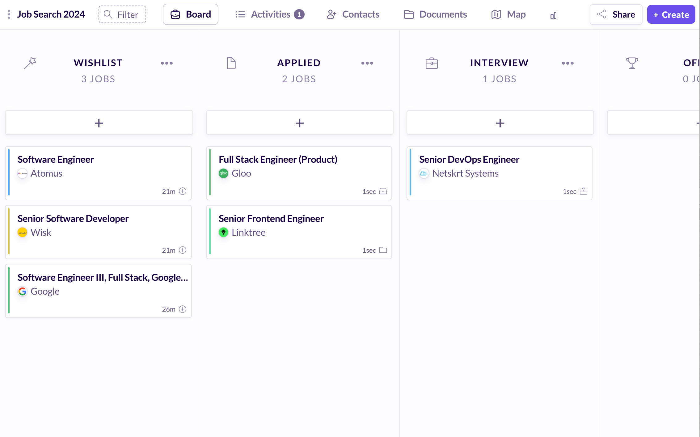
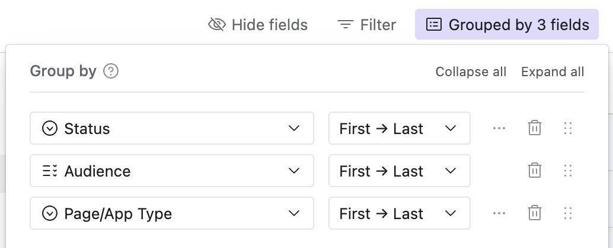
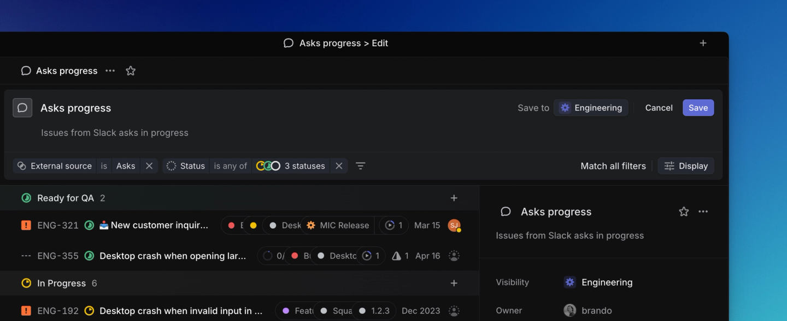

# JD 多维展示调研

当前方向：[JD 无限画布专项调研](jd-infinite-canvas-research.md)，包含官方界面图和本项目的画布构图。

2026 年 11 月 20 日补充：[结合现有浮窗与真实数据结构的第二轮调研](jd-view-research-round-2.md)。下文保留第一轮行业案例，第二轮重新评估了页面入口和展示方式。

调研日期：2026 年 11 月 19 日。范围为求职跟踪、结构化记录浏览、自定义视图。案例依据产品公开页面与官方界面图，未登录产品实测。本文用 JD 指一条职位记录，职位描述正文单独讨论。

## 结论

建议在扩展里新增「职位」页，首屏采用**可筛选、可分组的职位列表**。提供「全部职位」「按公司」「按状态」三个入口，共用搜索、筛选和职位详情。公司多的时候可以折叠组，已知要找的公司可以直接搜；状态入口适合查看「待自己回复」「面试中」这类跨公司队列。案例里，Airtable 最适合做主视图参考，Linear 适合参考如何把常用条件保存成视图，Huntr 适合参考状态看板。

| 用户想做的事 | 推荐呈现 | 行内优先信息 |
| --- | --- | --- |
| 看同一家公司的不同职位 | 按公司分组，点公司名可聚焦该公司 | 职位名、有效状态、地点、薪资、最近互动 |
| 看同状态下的不同职位 | 按状态分组，点状态可聚焦队列 | 职位名、公司、最近互动 |
| 看某些条件下的职位、公司和状态 | 顶部多条件筛选，结果可继续按公司或状态分组 | 职位总数、涉及公司数、各组职位数 |
| 查看某条 JD 和相关备注 | 点行打开详情，返回时保留筛选和滚动位置 | 原职位链接、职位属性、状态来源、职位备注、公司备注 |

## 成熟案例与界面

### Huntr · 按阶段排开的求职看板

横向各列表示求职阶段，职位以卡片呈现，卡片上能同时扫到公司和职位。同一列自然回答「这个阶段有哪些机会」。适合每天扫一遍进度，或针对少数阶段集中跟进。本项目状态粒度较细，直接平铺状态列会拉长看板；可在后续引入用户可切换的少量阶段列，并保留每张卡片的具体状态。若支持拖动，拖动应当有清楚的人工状态写入语义。

来源：[Huntr · Job Application Tracker & CRM](https://huntr.co/product/job-tracker)，图为官方产品展示图。

### Airtable · 可折叠分组表格

表头保持一致，数据按字段值分段，工具栏管理分组字段及组序，支持展开和折叠。文档还展示了多字段分组。可直接迁移到本项目：用公司和状态作为可切换的分组字段，组内仍是职位行，可以逐列比较。第二层分组可留给后续的「公司 → 状态」等场景，首版用筛选和单层分组就能覆盖主要需求。

来源：[Airtable Help Center · Grouping records in Airtable](https://support.airtable.com/docs/grouping-records-in-airtable)，图为官方帮助文档截图。

### Linear · 将常用筛选保存成命名视图

把一组筛选保存为有名字的入口，打开后得到一份按当前数据计算的列表。对求职来说，「待我回复」「收藏且在上海」「某公司进行中的职位」都可以用同一套视图能力表达。适合参考其视图入口与结果列表的关系；首版可以用固定入口验证哪些组合经常复访，再决定是否开放保存和管理自定义视图。

来源：[Linear Docs · Custom Views](https://linear.app/docs/custom-views)，图为官方帮助文档截图。

## 推荐页面结构

以下为本项目线框，数据为示例。右侧详情在窄屏可独立打开，返回时仍停在原分组和职位。

~~~text
职位                                  账号 ▾
全部职位     按公司     按状态

搜索职位或公司                        筛选 ▾
[上海 ×] [已收藏 ×]                   清空条件
6 个职位 · 3 家公司                   最近互动 ▾

▾ 示例科技 · 3 个职位
  职位            状态         地点   最近互动
  产品经理        待自己回复   上海   11 月 18 日
  数据产品经理    面试中       上海   11 月 17 日
  商业策略        待确认       上海   —
▸ 示例数据 · 2 个职位
▸ 示例软件 · 1 个职位

选中「数据产品经理」 → 职位详情
职位属性 · 状态来源 · 备注 · 原职位链接
公司备注 · 查看该公司全部匹配职位
~~~

### 浏览、分组与筛选

- 「全部职位」列出当前账号可见职位。「按公司」按公司记录分组，显示各公司在当前条件下的职位数。「按状态」按有效状态分组，公司名保留在职位行里。
- 公司、状态、收藏、地点可以作为首批筛选项。不同筛选维度取交集，同一维度多选取并集。例如「上海 × 已收藏 ×（面试中或待自己回复）」。职位标题和公司名共享搜索框。学历、经验、薪资可等字段覆盖与格式稳定后再扩充。
- 先筛选再分组，各组的数字随筛选更新。按公司时，点公司组展开同公司职位；按状态时，点状态组展开该状态职位。也可从详情里的公司名进入单公司范围，并保留其他筛选条件。
- 三个入口共用当前筛选。全部职位与组内默认按最近互动排序，无互动记录排在末尾；如果首版只能取得记录更新时间，就直接用「记录更新」作为列名和排序项。
- 将零结果、没有采集数据、同步中和账号尚未识别分别呈现。部分采集场景显示「当前账号已记录的职位」，计数口径为当前可见的唯一职位数。

### 还有哪些形式值得保留

| 形式 | 适合的场景 | 采用时机 |
| --- | --- | --- |
| 公司汇总表 | 先比较公司，每行显示职位总数和代表状态，点击展开或进入该公司 | 用户频繁先找公司、同公司职位较多时 |
| 状态看板 | 逐阶段扫一遍待跟进机会，卡片呈现公司和职位 | 有稳定的阶段集合，并且看板能提升日常跟进效率时 |
| 公司 × 状态矩阵 | 快速对照各公司各状态的职位数量，点击数字钻取职位 | 多家公司都存在多个职位且经常横向比较时 |
| 命名视图 | 反复回访同一组条件，如「本周要跟进」 | 固定入口之外出现可重复的筛选组合时 |

## 和现有项目的衔接

| 项目现状 | 页面设计含义 |
| --- | --- |
| 扩展独立页当前主要处理采集进度和导出 | 「职位」可作为独立入口，沿用现有账户选择与本地数据 |
| 后台保存职位、公司和会话的关联，按账号返回可见数据 | 用账号内的职位 ID 去重、按公司 ID 分组。一个职位关联多条会话时仍只显示一行 |
| 现有公司键基于标准化名称 | 同名可能归并，别名可能分开。使用现有公司归属，给缺失公司单独显示「公司待确认」 |
| 有效状态由人工标记优先，自动状态其次 | 用有效状态筛选与计数，详情显示状态来源。旧面试轮次沿用现有归一化规则 |
| 收藏、薪资、地点、经验、学历可能有值，记录也可能只有少量字段 | 对缺失值显示「未记录」。收藏且无会话的职位可出现在列表中，无须推断成已沟通 |
| 本轮核查的职位写入路径未见统一保存完整 JD 正文 | 首版详情显示已有职位信息和原链接。若未来要在页面内阅读完整正文，需另定正文采集范围、覆盖提示及更新策略 |

本地依据：[独立页](../extension/src/dashboard.tsx)、[后台职位写入与数据读取](../extension/src/background.ts)、[合并和有效状态逻辑](../extension/src/core.ts)、[状态标签及归一化](../extension/src/status.ts)、[记录类型](../extension/src/types.ts)。

## 首版范围与验收场景

建议首版交付三个入口、搜索、组合筛选、可折叠分组和只读详情。以下场景可用本地 mock 验证。

1. 同公司三个不同职位，展开公司组能看全三个；两个同名职位但职位 ID 不同，分别显示。
2. 选择「面试中」可看到多家公司的职位；同一职位关联两条会话时，列表和组计数都只计算一次。
3. 选择「上海」和「已收藏」后，在公司和状态入口来回切换，匹配职位集合一致，分组方式与计数正确。
4. 某职位有人工状态且与自动状态不同，按人工状态进入相应组，详情能看出状态来源。
5. 职位只有收藏或缺少地点、薪资、公司等字段时，仍可在合适的范围中找到，缺失信息有明确显示。
6. 打开某职位详情再返回，保留筛选、展开状态和滚动位置。切换账号后，仅展示目标账号可见数据。

公开对照中也尝试访问了 Teal 的职位跟踪工具页，该页面返回 403，本报告的界面比较以成功获取的三个官方案例为准。
